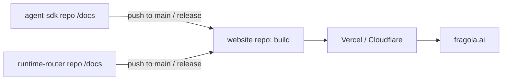

# Fragola Web Strategy

Org: `fragola` (GitHub). Domain: `fragola.ai`.
Projects: **Agent SDK** and **Runtime Router**, each in its own GitHub repo, each owning its docs in-repo.

## 1. Goals

- One coherent brand at `fragola.ai`, with each project feeling first-class.
- Bun-inspired docs layout: a top bar with product and per-product docs version switchers, a vertical left sidebar for all docs navigation, and a right "on this page" rail. No secondary horizontal docs navigation.
- Docs stay versioned with code (live in each repo, changed in the same PR as the code).
- Switching products must feel instant and seamless (no visible "different site").

## 2. Site map (recommended)

| URL | Purpose | Source |
|---|---|---|
| `fragola.ai` | Org landing: mission, both projects, community, blog highlights | `fragola-ai/website` repo |
| `fragola.ai/agent-sdk` | Agent SDK home (marketing) | `website` repo |
| `fragola.ai/router` | Runtime Router home (marketing) | `website` repo |
| `fragola.ai/docs/agent-sdk/*` | Agent SDK docs | `agent-sdk` repo `/docs` |
| `fragola.ai/docs/router/*` | Runtime Router docs | `runtime-router` repo `/docs` |
| `fragola.ai/blog` | Org-level blog / changelog | `website` repo |
| `fragola.ai/about`, `/community` | Org pages | `website` repo |

Alternative: subdomains per product (`agent-sdk.fragola.ai`, `router.fragola.ai`). Not recommended, see section 3.

## 3. Path-based vs subdomain

| | Path-based (`/docs/<product>`) | Subdomains |
|---|---|---|
| SEO | Domain authority is shared | Authority is split (treated as separate sites) |
| Product switcher | Client-side navigation, no reload | Full page load / cross-origin |
| Shared header/search/theme | Trivial | Must be duplicated or shared via package |
| Cookies / theme / analytics | Same origin | Needs cookie domain config |
| Deployment independence | Needs composition (see below) | Natural |
| Complexity | Moderate | Low per-site, higher overall |

**Recommendation: path-based**, with one site that composes content from both repos.

## 4. Architecture options

### Option A: Single docs site, content pulled from repos (recommended)

One Next.js (or Astro/Fumadocs/Docusaurus/Starlight) app in a `website` repo. At build time it fetches `/docs` from each project repo and mounts them under `/docs/<product>`.



How content is pulled (pick one):

1. **Git submodules** in `website/content/<product>`. Simple, pinned to commits; needs bump PRs (automate with Renovate/Dependabot or a workflow).
2. **Build-time clone/sparse-checkout** script (`git clone --depth 1 --filter=blob:none --sparse`) of each repo at a configured ref (`main` for "latest", tags for versions). No bump PRs, always fresh.
3. **Publish docs as an npm package** (`@fragola-ai/agent-sdk-docs`) from each repo's release workflow; website depends on it. Gives true versioning, slower to iterate.

Triggering rebuilds: each project repo has a GitHub Action on `push` to `main` (docs paths) that calls a `repository_dispatch` to the website repo, or a Vercel/Cloudflare Deploy Hook URL. Result: docs PR merged -> site live in minutes.

Pros: single design system, single search, instant product switching, one SEO domain.
Cons: website repo is a coupling point; docs preview for a PR in a project repo needs extra setup (see section 8).

### Option B: Independent docs sites + reverse proxy / rewrites

Each repo deploys its own docs app (e.g. `agent-sdk-docs.vercel.app`). `fragola.ai` rewrites `/docs/agent-sdk/*` to that deployment (Next.js `rewrites`, Vercel `rewrites`, Cloudflare Worker, or Nginx).

- Pros: full deploy independence, PR previews native to each repo.
- Cons: the shared navbar/theme must be duplicated or shipped as a shared package (`@fragola-ai/web-ui`); asset paths need `basePath`/`assetPrefix` set correctly; switching products is a full page load (cross-app) unless handled carefully; search is split.

### Option C: Fully separate sites + redirects

Not recommended: redirect-based switching is jarring and loses the "one org" feel.

**Recommendation: Option A**, optionally evolving to B only if the teams need hard deploy independence.

## 5. Product switching (answering "redirect?")

With Option A, **no redirect is needed**. The switcher is a normal client-side link in the shared navbar:

- Agent SDK link -> `/docs/agent-sdk` (or the last page visited in that product).
- Runtime Router link -> `/docs/router`.

Details:

- **Persist last location per product**: store the last visited path per product in `localStorage`; when the user switches back, link to that path instead of the root. Fall back to the product's "Welcome" page.
- **Active product** is derived from the URL's first segment after `/docs`. Highlight it in the navbar.
- **Sidebar** is driven by a per-product config (`meta.json` / `sidebar.ts`) shipped inside each repo's `/docs`, so each team controls its own navigation.
- **Search** (Cmd/K or `/`): scope defaults to current product, with a toggle for "All docs". Use Pagefind / Orama / Algolia DocSearch with a `product` facet.

Redirects are still useful for:

| From | To | Why |
|---|---|---|
| `/docs` | `/docs/agent-sdk` (or a docs landing picker) | No bare docs root |
| `/docs/agent-sdk` | `/docs/agent-sdk/welcome` | Default page |
| Old URLs (`/docs/foo`) | `/docs/agent-sdk/foo` | Legacy links, if the current docs have existing URLs |
| `/sdk`, `/agent` | `/agent-sdk` | Vanity aliases |
| `docs.fragola.ai` | `fragola.ai/docs` | Subdomain convenience |

Use permanent (301/308) redirects in `next.config` / `vercel.json` / `_redirects`, and keep a redirects file per product in the repo so renamed pages do not break links.

## 6. Layout (Bun-style)

```
┌──────────────────────────────────────────────────────────────┐
│ logo  [Agent SDK] [Runtime Router] [v1.2 ▾] (search) GitHub ☾ │  <- product + docs version switchers
├────────────────┬──────────────────────────────┬───────────────┤
│ Vertical       │ Breadcrumb                   │ On this page  │
│ docs sidebar   │ H1 + content                 │ (headings)    │
│ Guides         │                              │ Copy page ▾   │
│ API Reference  │ prev / next                  │               │
│ Hooks          │                              │               │
└────────────────┴──────────────────────────────┴───────────────┘
```

Notes:

- On docs pages, the top bar contains the org logo, product switcher (pill-style active state), version switcher, search, GitHub link, and theme toggle. The version switcher lists only versions available for the active product. The bar has no docs-section tabs.
- On non-docs pages, hide the docs version switcher; the product switcher remains available.
- All docs navigation (Guides, API Reference, Hooks, Examples, etc.) lives in the vertical sidebar and is driven by the active product's config.
- Include a "Copy page" / "View as Markdown" button and serve `/llms.txt` + `/llms-full.txt` per product (`/docs/agent-sdk/llms.txt`), useful for an AI-focused org.
- "Edit this page on GitHub" links point to the right repo based on product.
- Framework candidates that give this layout with little work: **Fumadocs** (Next.js, multi-source, tree-based sidebar), **Docusaurus** (multi-instance docs plugin), **Starlight** (Astro). Each product's sidebar is selected by the product switcher and populated from that repo's docs configuration.

### Logo and navigation rules

The logo always links to the org home (`fragola.ai`), on every page (docs, product pages, blog). Product home stays reachable without using the logo.

| Element | Target |
|---|---|
| Logo | `fragola.ai` (org home) |
| Product pill in navbar (e.g. Agent SDK) | Product docs root, or last visited page (see section 5) |
| Docs version switcher | Versions available for the active product; changing product updates the version list |
| Docs breadcrumb first item / product-home link | Product home (`/agent-sdk`) |
| Product home navbar | Same global navbar and product switcher; use page content links for Docs and GitHub |
| Org home | Two product cards, each linking to product home + docs |

Why org home, not product home:

- The brand is the org; the product is shown by the active pill, so the logo does not need to carry that context.
- Single consistent rule, with no "where does the logo go on this page" ambiguity.
- Switching between products from the org home needs no extra navigation concept.
- Sites such as Bun have a single product, so logo -> product home is the same as logo -> org home. With two products, logo -> product home would make the org page undiscoverable from docs.

Optional: show the product name next to the logo in docs (`[logo] / Agent SDK`) to reinforce context without changing the logo target.

## 7. Content contract between repos and website

Each project repo exposes a stable docs folder:

```
<repo>/docs/
  meta.json            # sidebar/tab structure
  index.mdx            # product docs landing ("Welcome to X")
  guides/...
  reference/...
  assets/...           # images referenced relatively
  redirects.json       # optional: old -> new paths
```

Rules:

- Frontmatter schema is shared (`title`, `description`, `icon`, `sidebar_position`); validate in CI with a script published from the website repo.
- Relative links and assets only (no hardcoded `fragola.ai/docs/...`), so the site can mount docs under any base path.
- Cross-product links use a token (e.g. `fragola://router/guides/foo`) resolved at build time, or absolute `/docs/router/...` paths.
- Generated API reference (typedoc etc.) is produced in the project repo CI and committed to or published alongside `/docs`.

## 8. Versioning and previews

- Each product has its own version switcher and version catalog, sourced from that product repo's release tags. Agent SDK and Runtime Router can release on different schedules and show different version lists.
- Use explicit versioned routes: `/docs/agent-sdk/v1.2.0/...` and `/docs/router/v0.8.0/...`. The unversioned product root (for example, `/docs/agent-sdk`) resolves to that product's latest stable docs. A `next` entry may point to `main`/`next` and should be clearly labeled as prerelease.
- Preserve the current page when switching versions if that page exists in the target version; otherwise navigate to the target version's docs landing page and show a brief notice that the page is unavailable in that version.
- Build versioned docs from git tags and retain supported versions according to each project's support policy. For older versions, keep the docs available even if they are no longer supported, but label them as end-of-life.
- **PR previews**: in each project repo, a GitHub Action checks out the website repo, points it at the PR's docs folder, and deploys a preview (Vercel/Cloudflare preview URL commented on the PR). This is the main cost of Option A and worth setting up early.
- **Link checking** in CI on both sides.

## 9. Home pages

- `fragola.ai` (org): short pitch, two product cards (Agent SDK, Runtime Router) with a one-line value prop + install snippet each, how they fit together (diagram), GitHub/Discord links, latest blog posts, sponsors/contributors.
- `fragola.ai/agent-sdk` and `/router`: product landing pages (hero, install snippet, feature grid, code sample, "Get started" -> docs, GitHub stars). Same navbar as docs so the switcher is present everywhere.
- Decision: **one site for the org + products**. A separate org site is only justified if the org grows beyond these products (many projects, foundation-style governance). Until then, the org landing is just `/`, and the product pages hang off it.

## 10. Is a dedicated org website worth it?

| Option | When |
|---|---|
| Org landing is `fragola.ai/` inside the same site (recommended) | Two products, small team |
| Separate org site (`fragola.org` or `about.fragola.ai`) | 4+ products, governance/foundation content, sponsors, legal |
| Only GitHub org profile README | Minimum viable; pair with the website anyway |

Also set up the GitHub org profile (`fragola/.github` repo with `profile/README.md`) linking to `fragola.ai`, plus the shared community health files (`CONTRIBUTING`, `CODE_OF_CONDUCT`, issue templates) in that same `.github` repo.

## 11. Hosting, DNS, and infra

- Host: Vercel or Cloudflare Pages (static/ISR output). Cloudflare gives free CDN, rewrites, Workers, and DNS in one place.
- DNS: apex `fragola.ai` -> host; `www` redirects to apex (or inverse, pick one canonical).
- Reserved subdomains (optional): `docs.fragola.ai` -> redirect to `/docs`; `registry.fragola.ai` (e.g. private npm / Verdaccio) kept separate; `status.fragola.ai`; `api.fragola.ai` for the router's hosted endpoints if ever offered. Keep runtime/API traffic off the marketing site's domain root.
- Analytics: Plausible / PostHog, single property, with a `product` dimension derived from the path.
- SEO: single sitemap with per-product sections, canonical URLs, OpenGraph images per product, `robots.txt`.

## 12. Repo layout summary

```
fragola/website            -> fragola.ai (Next.js/Fumadocs app, org + product pages, blog)
fragola/agent-sdk          -> code + /docs (pulled by website)
fragola/runtime-router     -> code + /docs (pulled by website)
fragola/.github            -> org profile + community health files
fragola/web-ui (optional)  -> shared components/theme, only needed for Option B
```

## 13. Rollout plan

1. Register/point `fragola.ai`, create `website` repo, deploy a placeholder org landing.
2. Build the Bun-style docs shell (product and version switchers, vertical sidebar, search) with Agent SDK content pulled from its repo.
3. Add the content contract (`meta.json`, frontmatter validation) and the repo-to-website rebuild trigger.
4. Add Runtime Router docs once it has content; the switcher appears with both products.
5. Product landing pages, then blog/changelog.
6. PR previews, link checks, `llms.txt`, and per-product version catalogs generated from release tags.

## 14. Decisions to confirm

- Path-based routing under one domain (vs subdomains).
- Docs framework (Fumadocs vs Docusaurus vs Starlight).
- Content pull mechanism (submodule vs build-time clone vs npm package).
- Version retention and support policy for each product, and whether to include a `next` docs channel.
- Route names: `/router` vs `/runtime-router`, `/agent-sdk` vs `/sdk`.
